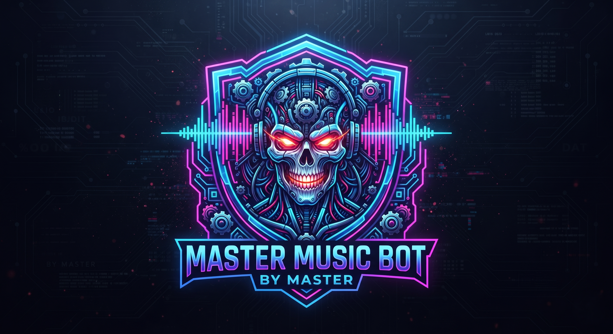

<p align="center">
  
</p>

<h1 align="center">⚡ MASTER MUSIC PROTOCOL v5.0 ⚡</h1>
<p align="center">
  <b>A Next-Generation Decentralized AI Humanoid Audio & Video Streaming Daemon for Telegram</b>
</p>

<p align="center">
  
  
  
  
</p>

---

### 🚀 **CORE ARCHITECTURE & FEATURES**
* **Ultra-Fast Zero-Lag Streaming:** Optimized yt-dlp client spoofing (`android`, `web`) for instant stream extraction.
* **Simultaneous Audio & Video (`/vplay`):** Powered by PyTgCalls `AudioVideoPiped` for perfect sync delivery and crystal-clear audio-video playback in voice chats.
* **Strict 100-Track Queue System:** Managed queue architecture with automated track-switching and real-time controls.
* **Anti-Ban Shield Protection:** Automated 5-minute cooldown rest timer after prolonged continuous playback to prevent Telegram flood limits and account bans.
* **Modular Security & Telemetry:** Group moderation suite (`/ban`, `/unban`, `/promote`, `/demote`), global security (`/gban`, `/gmute`), and audit logging to designated log group.

---

### 🛠️ **LOCAL & VPS INSTALLATION & 24x7 RUNNING**

Run the following commands sequentially in your terminal (`D:\Music` or Linux VPS):

```bash
# 1. Clone the repository
git clone [https://github.com/OfficialSpyder/Music.git](https://github.com/OfficialSpyder/Music.git)
cd Music

# 2. Create Python virtual environment
py -3.11 -m venv venv   # (Linux: python3.11 -m venv venv)

# 3. Activate virtual environment
venv\scripts\activate   # (Linux: source venv/bin/activate)

# 4. Install dependencies
pip install -r requirements.txt

# 5. Configure environment variables
nano config.py 
```

🖥️ Screen Shortcuts & Management (Important):
Once your bot is running using python main.py inside the screen session:

Detach & leave bot running in background: Press Ctrl + A then press D

Reattach/View the running bot console:

Bash
`screen -r mastermusic`
List all active background screens:

Bash 
`screen -S mastermusic`

Bash
`screen -ls`
Stop/Kill the background bot session:

Bash
`screen -X -S mastermusic quit`

⚙️ CONFIGURATION (config.py)
Ensure your config.py file contains the correct cluster credentials:

Python
import os

API_ID = int(os.getenv("API_ID", "your_api_id"))
API_HASH = os.getenv("API_HASH", "your_api_hash")
BOT_TOKEN = os.getenv("BOT_TOKEN", "your_bot_token")
STRING_SESSION = os.getenv("STRING_SESSION", "your_string_session")
LOGGER_ID = int(os.getenv("LOGGER_ID", "-100xxxxxxxxxx"))
START_IMG = "start.png"

📋 COMMAND DIRECTORY
🎵 Audio & Video Streaming
/play <query> - Stream high-fidelity audio into group voice chat.

/vplay <query> - Stream synchronized video and audio into voice chat.

/skip - Skip current track and play the next in queue.

/stop or /end - Terminate stream, clear queue, and leave voice chat.

🛡️ Group Moderation & Security
/ban - Permanently restrict a user (Admin/Owner only, with log notification).

/unban - Lift ban restrictions from a user (Admin/Owner only).

/promote - Elevate a user to Administrator with full privileges (Admin/Owner only).

/demote - Revoke administrative privileges (Admin/Owner only).

/gban - Execute network-wide global synchronization ban (Sudo/Owner only).

/gmute - Broadcast global mute enforcement across active clusters (Sudo/Owner only).

⚡ Telemetry & Utilities
/start - Launch the cyberpunk control panel with notification logging.

/help - Open the interactive command directory.

/ping - Inspect cluster network latency.

/speedtest - Run server bandwidth diagnostics.

Ab is README me installation steps ke sath hi screen session commands aur Ctrl + A, D shortcut ekdum proper flow me set kar diya hai. Ise save kar le! 🔥🚀

# 6. Start bot in a 24x7 Background Screen Session (Recommended for VPS)
screen -S mastermusic
python main.py
